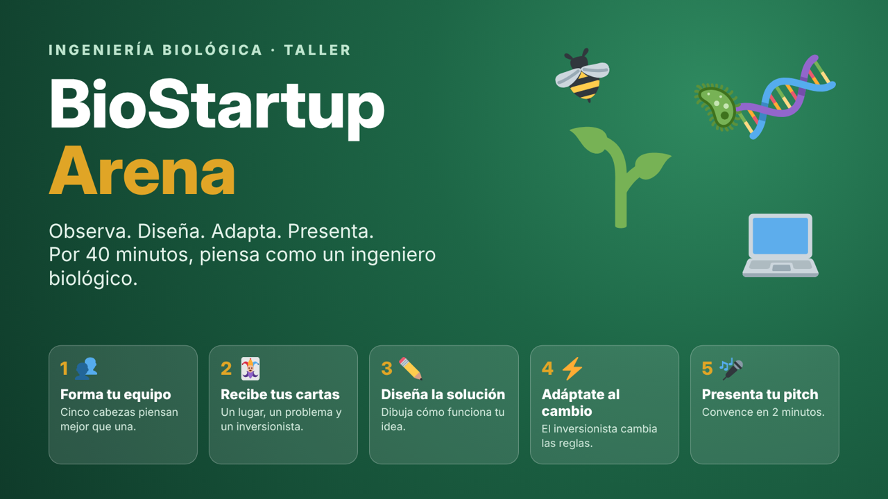

# BioStartup Arena

Taller de 40 minutos para estudiantes de **décimo y once** que les permite vivir, en equipo, el trabajo de un ingeniero biológico. Cada equipo recibe al azar un **contexto** de la región, un **problema** y un **inversionista** ficticio. Con esas tres cartas diseña a mano una solución que una la biología con los datos y la tecnología, se adapta a un cambio de condiciones a mitad del tiempo y la defiende en un pitch de 2 minutos.

El taller presenta los dos enfoques del programa de **Ingeniería Biológica de la Universidad de San Buenaventura Cali**:

- **Agricultura regenerativa:** producir alimentos recuperando el suelo, el agua y la biodiversidad.
- **Bioinformática, datos e inteligencia artificial:** usar computadores, sensores, ADN y algoritmos para entender a los seres vivos y tomar mejores decisiones.

> BioStartup Arena es una adaptación de **[Startup Arena](https://github.com/leidy-jaramillo/StartupArena)**, creada por la profesora **Leidy Jaramillo** para la asignatura Diseño detallado de Software. La adaptación se hizo con su autorización.

## Abrir el aplicativo

**En línea:** [lfdelgadom.github.io/BIOSTARTUP](https://lfdelgadom.github.io/BIOSTARTUP/)

**Sin internet:**

1. Descarga [`index.html`](index.html) (botón **Download raw file**) o todo el repositorio desde **Code → Download ZIP**.
2. Abre `index.html` con doble clic en Chrome, Edge o Firefox.

Es un solo archivo con todas las imágenes integradas. No necesita servidor, registro, instalación ni conexión.

## Archivos

| Archivo | Para qué sirve |
|---|---|
| [`index.html`](index.html) | El aplicativo completo: presentación del taller, sorteo, tiempos, evaluación y Podium. |
| [`Hoja-de-trabajo-en-blanco.pdf`](Hoja-de-trabajo-en-blanco.pdf) | Hoja tamaño carta para cada equipo: las tres cartas, el cambio del inversionista, el dibujo de la solución y la guía del pitch. |
| [`Tarjetas-para-recortar.pdf`](Tarjetas-para-recortar.pdf) | Las 33 cartas en 4 páginas, 9 por página, por si se quieren usar físicas. |

## Cómo funciona el taller

Está pensado para 30 estudiantes en 6 equipos de 5. Admite hasta 10 equipos por ronda.

| Momento | Tiempo | Qué ocurre |
|---|---|---|
| Presentación | 5 min | Se proyecta «La actividad»: qué es la Ingeniería Biológica, sus enfoques y la dinámica. Se forman los equipos. |
| Sorteo y diseño | 20 min | El docente sortea las tres cartas de cada equipo y arranca su reloj. Los equipos dibujan su solución en la hoja de trabajo. |
| Cambio del inversionista | Minuto 10 | El aplicativo revela automáticamente una nueva condición y una pregunta. Los equipos ajustan su solución. |
| Pitch | 12 min | Cada equipo presenta en 2 minutos: problema, solución, impacto y respuesta al cambio. El docente evalúa. |
| Podium y cierre | 3 min | Se muestran los tres primeros lugares y se relaciona la experiencia con la carrera. |

Los tiempos de 20 minutos con cambio a los 10 vienen precargados y se pueden modificar para cada equipo.

## Qué incluye el aplicativo

- **La actividad:** presentación para los estudiantes, con objetivo, enfoques del programa, dinámica, ejemplo resuelto, entregables y cierre.
- **Sorteo y equipos:** asignación aleatoria sin repetición de 13 contextos, 10 problemas y 10 inversionistas, con un reloj por equipo.
- **Cambio de condiciones:** cada inversionista trae una restricción y una pregunta que llegan en el minuto programado.
- **Imprimir hoja:** cada equipo tiene un botón que imprime su hoja de trabajo con sus tres cartas ya puestas.
- **Entrega:** foto del dibujo de la solución y confirmación de entrega.
- **Guía del docente:** paso a paso para conducir el taller.
- **Evaluación:** 10 criterios de Sí/No; cada «Sí» suma 10 %.
- **Resumen CSV y Podium:** porcentaje de cada equipo y los tres primeros lugares, con empates compartidos.
- **Vista de lectura:** texto ampliado de las cartas y descripción de las imágenes.

## Las cartas

### A · Contextos (13)

Lugares del Valle del Cauca y el Pacífico:

1. Finca cafetera en la montaña
2. Ingenio de caña de azúcar
3. La huerta del colegio
4. Cultivo de cacao en el Pacífico
5. El río Cauca
6. Plaza de mercado de Cali
7. Banco de semillas nativas
8. Humedal
9. Vivero comunitario
10. Cultivo de frutales
11. Huerta urbana en una terraza
12. Laboratorio de biotecnología
13. Finca ganadera en transición

### B · Problemas (10)

| Agricultura regenerativa | Bioinformática, datos e IA |
|---|---|
| P1 · Suelo cansado | P6 · Plaga silenciosa |
| P2 · Agua desperdiciada | P7 · Enfermedad misteriosa |
| P3 · Desaparecen las abejas | P8 · Clima impredecible |
| P4 · Demasiados químicos | P9 · Vida invisible en el suelo |
| P5 · Residuos que se botan | P10 · Datos perdidos en cuadernos |

### C · Inversionistas (10) y su cambio de condiciones

Todos los inversionistas y montos son ficticios.

| Inversionista | Busca | Cambio a mitad de tiempo |
|---|---|---|
| Cooperativa Raíces del Valle | Soluciones baratas para pequeños agricultores | Sin internet en la finca, solo un celular básico |
| Fondo Verde Pacífico | Recuperar ecosistemas | Demostrar con datos que el ambiente mejora en 6 meses |
| AgroData Labs | IA y datos para decidir mejor | La IA debe explicar sus recomendaciones; el agricultor decide |
| Cosecha Grande S.A.S. | Producir más y de forma rentable | Producir el doble sin dañar el suelo ni el agua |
| Alcaldía de Valle Verde | Beneficio para la comunidad y empleo | El presupuesto se recorta a la mitad |
| Fundación Bosque Vivo | Proteger la biodiversidad | Prohibidos los químicos sintéticos |
| BioGen Ventures | Biotecnología | La solución debe usar ADN o microorganismos |
| Red de Jóvenes Rurales | Jóvenes que se quedan en el campo | La operan jóvenes sin formación técnica |
| AseguraCampo | Reducir el riesgo de perder cosechas | Llegó El Niño: la mitad del agua durante 3 meses |
| Mercado Justo Internacional | Productos sostenibles para exportar | Trazabilidad total, de la semilla al comprador |

## Criterios de evaluación

1. Entendieron el contexto asignado y lo usaron en su propuesta.
2. La solución ataca el problema planteado.
3. La solución usa la biología: seres vivos, suelo, microorganismos o ecosistemas.
4. La solución usa datos o tecnología con sentido.
5. Tuvieron en cuenta lo que busca el inversionista.
6. Se adaptaron bien al cambio de condiciones del inversionista.
7. El dibujo de la solución se entiende y muestra cómo funciona.
8. La solución es realista para la región.
9. El pitch fue claro y convincente.
10. Todo el equipo participó en el diseño y en la presentación.

## Recomendaciones para el día del taller

- Abre el aplicativo antes de empezar en el computador que vas a usar, haz un sorteo de prueba y luego pulsa **Reiniciar sorteo**.
- Usa el mismo navegador durante todo el taller y mantén el computador encendido para que los cambios lleguen a tiempo. Si el equipo se suspende, los eventos vencidos se aplican al regresar.
- La evaluación se habilita cuando terminan los tiempos de todos los equipos. El Podium y el CSV se habilitan cuando están respondidos los 10 criterios de todos los equipos.

## Guardado de datos

Las asignaciones, los tiempos, los cambios, las fotos, las entregas y las evaluaciones se guardan en el navegador (`localStorage`). No se envían a ningún servidor ni se comparten entre computadores, ni siquiera al usar la versión en línea. El aplicativo no pide datos personales de los estudiantes: solo registra un nombre por equipo.

Borrar los datos del navegador o confirmar **Reiniciar sorteo** elimina la ronda.

## Créditos

- **Aplicativo original:** [Startup Arena](https://github.com/leidy-jaramillo/StartupArena), de la profesora Leidy Jaramillo.
- **Adaptación para Ingeniería Biológica:** Luis Fernando Delgado Muñoz, Universidad de San Buenaventura Cali.
- **Íconos de las cartas e ilustraciones:** [Twemoji](https://github.com/jdecked/twemoji), licencia [CC BY 4.0](https://creativecommons.org/licenses/by/4.0/).
- **Trofeos del Podium:** tomados del aplicativo original.
- El nombre y el logo de la Universidad de San Buenaventura pertenecen a la institución.

Los contextos, problemas, inversionistas y montos son elementos de una dinámica educativa. Las organizaciones son ficticias.
